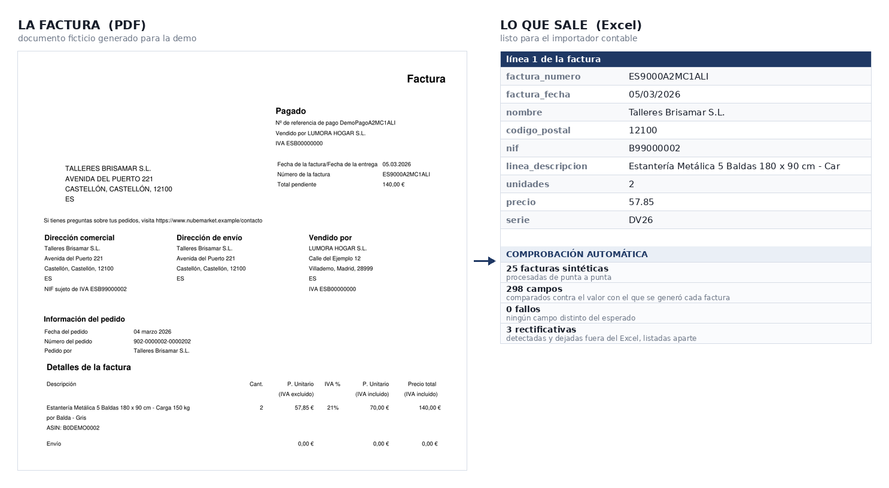

# Facturas PDF → Excel, con verificación automática

Una tienda online recibe cada mes decenas de facturas en PDF —ventas a través
de un marketplace, y compras de publicidad— y alguien las teclea a mano en el
Excel que importa el programa de contabilidad. Es trabajo lento, repetitivo y
de los que fallan en silencio: un dígito mal puesto no avisa.

Esta herramienta las lee y genera ese Excel. Construí la versión real para una
empresa de ecommerce española; lo que hay acá es una **reconstrucción con
facturas inventadas** que funciona igual.



## Qué resuelve

- **Facturas de venta** del marketplace: cliente, NIF, dirección, código
  postal, fechas, número de factura y de pedido, y una fila por producto más
  el envío. Distingue la venta nacional con IVA de la entrega intracomunitaria
  exenta según el NIF del cliente.
- **Facturas de compra de publicidad**, con el formato de Amazon Advertising y
  el de Meta: número, fecha e importe.
- **Rectificativas**: las detecta y **no las importa**. Las lista aparte para
  cargarlas a mano, que es lo que el cliente decidió que debía pasar.
- **No vuelve a agregar** una factura que ya está en el Excel, así que
  procesar dos veces el mismo lote no duplica nada.

## Lo que hace difícil este problema

Extraer texto de un PDF es fácil. Lo difícil es que **cuando la extracción
sale mal, no se nota**: el Excel se ve perfecto y el error aparece semanas
después, en la contabilidad.

Casos reales que hubo que resolver, y que están todos en las facturas de
prueba:

| Caso | Qué pasaba |
|---|---|
| Una palabra leída como NIF | El patrón de NIF no distinguía mayúsculas, y `VILLADEMO` entraba como NIF del cliente |
| CIF con letra de control | Los CIF de entidades (letra + 7 dígitos + letra) no coincidían con ningún patrón |
| Envío fantasma | En facturas francesas, `Date de la livraison 15.12.2025` creaba una línea de envío de 15,12 € |
| Envío con IVA | Se guardaba el importe con IVA en vez del precio unitario |
| Importes de 1.000 € o más | `1.024,50` se leía como `1,024` |
| Códigos postales con 0 | `08001` se convertía en `8001` |
| Rectificativas | Entraban como facturas positivas, sumando en vez de restando |

## Cómo se verifica

El generador de facturas sintéticas escribe también un `ground_truth.xlsx` con
los valores exactos que usó para dibujar cada factura. `verificar.py` ejecuta
el programa sobre los PDF y compara campo por campo contra esa verdad
conocida.

```
python generar_facturas_demo.py    # crea las facturas y el ground truth
python verificar.py                # ejecuta y compara
```

```
TOTAL: 298 comprobaciones correctas, 0 fallos
```

Las 25 facturas de prueba incluyen a propósito los casos difíciles: dos
formatos de fecha, un cliente portugués (intracomunitario, sin código postal),
códigos postales que empiezan por 0, una factura con varios productos, una con
envío, una en francés, un CIF con letra de control, importes de más de 1.000 €
y una rectificativa con las etiquetas partidas en varias líneas.

## Instalación

```bash
pip install -r requirements.txt
```

Para usarlo como lo haría una persona, con menú y ventana para elegir el PDF o
el ZIP:

```bash
python factuscan_demo.py
```

La ventana de selección necesita interfaz gráfica; la extracción no, así que
`verificar.py` corre igual en un servidor sin escritorio.

## Archivos

| Archivo | Qué es |
|---|---|
| `factuscan_demo.py` | El programa. Misma lógica de extracción que la versión real; cambian los nombres de las columnas de salida y la configuración. |
| `generar_facturas_demo.py` | Genera las 25 facturas sintéticas y el `ground_truth.xlsx`. |
| `verificar.py` | Ejecuta el programa y compara contra el ground truth, campo por campo. |
| `facturas/` | Las 25 facturas: 12 ventas, 3 rectificativas, 6 compras tipo Amazon y 4 tipo Meta. |

## Confidencialidad

Trabajé la versión real bajo cláusula de confidencialidad, así que nada de lo
que hay acá sale de ahí.

**Todos los datos son inventados.** La empresa (Lumora Hogar S.L.), sus
clientes y los importes se generan con `generar_facturas_demo.py`, y cada PDF
lleva la marca *DOCUMENTO FICTICIO – DEMO*. Los nombres de las columnas de
salida son genéricos: los reales pertenecen al importador de un programa
contable.

Las facturas imitan la **estructura** de las reales —etiquetas, posiciones y
orden del texto— para que el programa trabaje igual que con ellas. Los
formatos de Amazon Advertising y Meta se nombran porque son formatos públicos
de proveedores que usa medio mundo; lo que no aparece es ningún dato del
cliente para el que se construyó.
